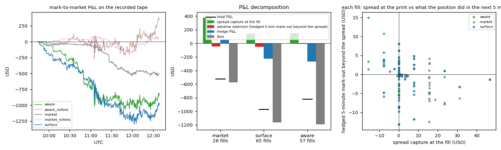
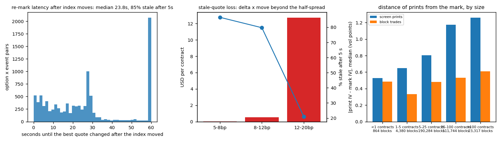

# options-mm

An options market-making stack on real option markets, in Python with a C++ implied-vol solver: an arbitrage-free surface engine (SSVI and SVI), a quoting engine replayed against 2.9 hours of recorded Deribit BTC option books (2,845,817 ticker updates, 386 options), an RFQ pricer for vol-desk structures, and measurements of quoting microstructure. The recorder in `tools/record.py` produced the tape on 2026-09-18 09:44 to 12:38 UTC.

The question: how much of an options market maker's edge is spread capture, and how much goes to adverse selection, hedging and fees?

## Results

- **All three quoters lose money after fees.** Quoting every option within 25 % of the index on five expiries at the screen's own half-spread, the quoter centred on Deribit's mark ended at -520 USD on 28 fills. Our surface as the centre ended at -971 USD on 65 fills, and the surface leaned by inventory at -821 USD on 57.
- **Fees are the cost.** Spread captured at the print was +377 / +140 / +151 USD, adverse selection -46 / -54 / -10 USD, and fees 576 / 1,165 / 1,191 USD. On 133 of 150 headline fills (89 %) the per-contract fee exceeds the spread captured at the print, against Deribit's mark. An independent check against the screen's quoted half-spread on the raw tape found 92 %. With fees off, the mark-centred and leaned quoters make +55 / +370 USD.
- **Protections matter more than the centre.** Without re-pricing off the live index, the fast-market pull and the hard vega limit, the leaned quoter makes -3,484 USD on 97 fills.
- **The screen is slow to re-mark.** After an index move of 5 bp or more, the best bid or ask took a median 23.8 s to change, and 85 % were unchanged after 5 s.
- **The surface fits.** 174 eSSVI surfaces on the tape fit to 0.74 vol points RMSE, with the fitted fair inside the bid-ask for 88 % of quotes.

| | market mark | our surface | surface + inventory lean |
|---|---|---|---|
| fills | 28 | 65 | 57 |
| spread captured at the print | +377 | +140 | +151 |
| adverse selection | -46 | -54 | -10 |
| hedge P&L (perpetual; not in the total) | +54 | -226 | -267 |
| fees | 576 | 1,165 | 1,191 |
| **P&L, USD** | **-520** | **-971** | **-821** |




All numbers are in `results/run.json` and `results/summary.md`; the detail is in [docs/method.md](docs/method.md).

## How it works

- **Surfaces.** SSVI slices (Gatheral and Jacquier 2014) on the tape, with butterfly and calendar checks. Raw SVI on the sparse listed chains of SPY, AAPL and NVDA. An implied-vol solver in C++ and numpy.
- **Quoting engine.** Replays the tape event by event. The three quoters post at the screen's own half-spread and differ only in the centre. The aware quoter leans by portfolio vega, after Baldacci, Bergault and Guéant (2021).
- **Fills.** A print at or through our price fills us once the displayed size ahead of us has traded. Delta is hedged every 30 seconds in the perpetual.
- **P&L.** Marked at Deribit's mark and split into spread, adverse selection, hedging and fees. Fees follow the public schedule.
- **Other pieces.** An RFQ pricer for straddles, risk reversals and calendars, and a study of pick-off after index moves, spread and depth, and block prints against the screen.

## Limitations

- The tape is 2.9 hours long. Fill counts are small and the ordering of the three centres is not established.
- It is a replay. Fills are inferred from prints against other people's quotes, and nothing we did would have changed the flow.
- The headline P&L omits the realised P&L on the perpetual hedge. In `optmm/mm.py`, `hedge()` adds it to `st.hedge_pnl_usd` but not to `cash_usd` or `mtm_usd()`. Adding it, an independent check puts the three totals at −466 / −1,197 / −1,088 USD, against the reported −520 / −971 / −821 USD. The code and results are unchanged here, because the raw tape is not available to rerun.
- Fees are the public schedule. A participant in Deribit's liquidity-provider programme pays close to nothing.

## Run

```
pip install -e .[test]
python build_ext.py build_ext --inplace      # C++ solver, optional
OPTMM_DATA=data/sample python -m optmm run --quick
python -m pytest -q                          # 24 tests
```

CI builds the extension, runs the tests and the whole pipeline on the committed sample. `python scripts/readme.py` regenerates this file and `docs/method.md` from `results/run.json`.
